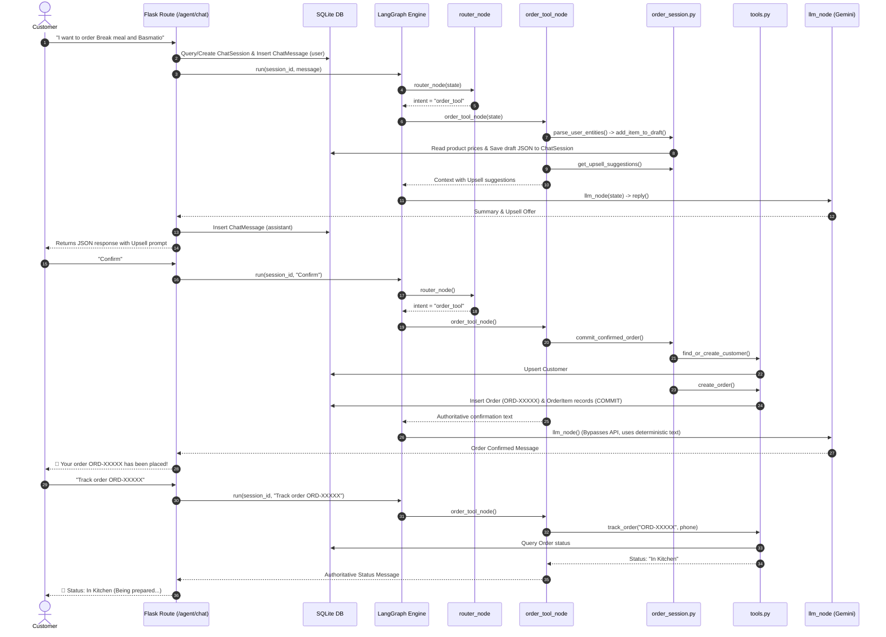

# Rest_Ai-Agent — Execution Tracing & Order Scenario Study Guide

> **Repository:** `C:\Users\Home\Desktop\Rest_Ai-Agent`  
> **Source of Truth:** Actual Python source files (`app/routes/admin.py`, `app/services/graph.py`, `app/services/order_session.py`, `app/services/tools.py`, `app/models/`).  
> **Notice:** This document is strictly local for exam and interview preparation and is ignored from Git.

---

## 1. Overview of the Order Lifecycle Architecture

The application implements a multi-turn, stateful conversational order pipeline using:
1. **Flask Entry Point (`app/routes/admin.py:agent_chat`)**: Receives POST request, ensures session persistence in SQLite (`ChatSession`), records message (`ChatMessage`), and invokes LangGraph.
2. **LangGraph State Machine (`app/services/graph.py:build_graph`)**:
   - `router_node`: Routes user intent (`restaurant_product`, `order_tool`, `recommendation`, `general`).
   - `order_tool_node`: Manages order entities, drafts, upsell logic, validation, and confirmation.
   - `llm_node`: Calls Gemini API or returns deterministic responses with a hallucination guard.
3. **Draft & Session Management (`app/services/order_session.py`)**:
   - Maintains real-time order drafts in memory (`_drafts`) and syncs to SQLite (`ChatSession.draft_data`).
   - Implements entity parsing (`parse_user_entities`), price calculation (`calculate_draft_totals`), and fulfillment validation (`get_missing_fields`).
4. **Database Tools & Models (`app/services/tools.py`, `app/models/`)**:
   - `create_order`: Generates `ORD-XXXXX`, computes line totals, creates `OrderItem` records inside a database transaction.
   - `track_order`: Looks up live order state from SQLite using `order_code`.
   *(Note: Placed/committed orders cannot be edited or cancelled; once placed, an order is final).*

---

## 2. Realistic Customer Conversation & Execution Trace

### Context: The Real Restaurant Menu
In the actual SQLite database (`Product` table), the menu consists of specific Egyptian restaurant items:
* Meals: `وجبة بريك` (235 EGP), `ربع فرخة بروستد` (135 EGP), `وجبة ستربس 3 قطع` (150 EGP), `وجبة ستربس 5 قطع` (205 EGP), `فتة` (160 EGP), `بسمتيو` (105 EGP).
* Add-ons & Sides: `باكيت بطاطس` (35 EGP), `أرز بسمتي` (25 EGP), `كول سلو` (15 EGP), `قطعة ستربس` (35 EGP).
* Drinks: `مشروب` (Pepsi/Drink - 25 EGP), `مياه` (Water - 10 EGP).
* Sauces: `باربكيو` (25 EGP), `شيدر` (35 EGP), `رانش` (15 EGP), `سويت تشيلي` (15 EGP), `ثومية` (15 EGP).

> **Scenario Adaptation Note:** Since generic "burgers" and "pizza" are not on this restaurant's chicken/broasted menu, the realistic scenario orders `وجبة بريك` (Break Meal) and `بسمتيو` (Basmatio Meal). If a customer asks for burgers, `search_products` returns no matching products and the agent informs them of available meals.

---

### Step 1 — Customer initiates order: "I want to order Break meal and Basmatio"

* **Customer Message:** `"I want to order وجبة بريك and بسمتيو"`
* **Actual Entry Point:** `app/routes/admin.py:agent_chat()`
* **What happens:**
  1. `agent_chat()` reads JSON `{"session_id": "sess_101", "message": "..."}`.
  2. Queries `ChatSession.query.filter_by(session_id="sess_101").first()`. If none exists, creates `ChatSession(session_id="sess_101", title="Chat 1")` and commits to SQLite.
  3. Inserts `ChatMessage(session_id="sess_101", role="user", content=message)` and commits.
  4. Calls `app.services.graph:run("sess_101", message)`.
* **Graph Invocation:**
  1. `_graph.invoke({"session_id": "sess_101", "message": message})` begins at entry point `"router"`.
  2. `router_node(state)` calls `_route_intent(message, session_id="sess_101")`. Matches keywords `"i want to order"` / `"order"`.
  3. `state["intent"]` is set to `"order_tool"`. Conditional edge directs execution to `order_tool_node`.
* **Order Tool Node Execution:**
  1. `order_tool_node(state)` runs `parse_user_entities("sess_101", message)`.
  2. `parse_user_entities` inspects available products from the database (`Product.query.filter(is_available=True)`):
     - Matches `وجبة بريك` -> calls `add_item_to_draft(session_id, "وجبة بريك", quantity=1)`.
     - Matches `بسمتيو` -> calls `add_item_to_draft(session_id, "بسمتيو", quantity=1)`.
  3. `add_item_to_draft` appends both items with DB unit prices (`235 EGP` and `105 EGP`) and calls `_save_draft_to_db`.
  4. `order_tool_node` checks Guided Upselling: `not draft["upsell_offered"]`.
  5. Calls `get_upsell_suggestions(draft)`. Both meals are eligible for combo upgrades (+50 EGP) and no drinks/sauces are added yet.
  6. `draft["stage"]` is set to `"offering_extras"`. `draft["upsell_offered"] = True`.
  7. Formats context with current draft summary (`340 EGP`) and Guided Upselling options.
* **LLM Node Execution:**
  1. `llm_node(state)` invokes `reply(session_id, message, context)`.
  2. Gemini presents the current draft summary and politely asks if the customer would like to upgrade meals to combo (+50 EGP for fries & drink) or add drinks/sauces.
* **Result Sent to Customer:**
  Summary showing 1x Break Meal (235 EGP) + 1x Basmatio (105 EGP) = 340 EGP, asking if they want combos, drinks, or sauces.

---

### Step 2 — Customer declines upsell: "No thanks"

* **Customer Message:** `"No thanks"`
* **Actual Entry Point:** `app/routes/admin.py:agent_chat()`
* **Execution Path:**
  1. `agent_chat()` records user message in SQLite.
  2. Graph `router_node`: Matches `decline_signals` (`"no thanks"`) while draft has items. Routes to `order_tool_node`.
  3. `parse_user_entities` flags `draft["upsell_declined"] = True` and sets `draft["stage"] = "collecting_details"`.
  4. `order_tool_node` calls `get_missing_fields(draft)`.
  5. `get_missing_fields` returns: `["order_type"]`.
  6. Context instructs: *"Next required information to ask for: Order Type (Delivery, Pickup, Dine-in). Ask for this field clearly."*
  7. `llm_node` asks: *"Would you like your order for Delivery, Pickup from a branch, or Dine-in?"*

---

### Step 3 — Customer provides order type: "Delivery"

* **Customer Message:** `"Delivery"`
* **Execution Path:**
  1. `router_node`: Message contains `"delivery"`, routes to `order_tool_node`.
  2. `parse_user_entities`: Matches `delivery_words`, calls `update_draft(session_id, order_type="delivery")`.
  3. `get_missing_fields(draft)` now evaluates delivery requirements:
     - Missing: `customer_name`, `customer_phone`, `delivery_address`, `payment_method`.
  4. First missing is `customer_name`.
  5. `llm_node` asks for the customer's name.

---

### Step 4 — Customer provides name, phone, address, and payment method

* **Customer Message:** `"My name is Ahmed, phone 01012345678, 15 El-Nasr St Maadi, Cash"`
  *(Note: Can also be provided across 4 separate individual messages; `order_session.py` evaluates `get_missing_fields()` sequentially at each step).*
* **Execution Path:**
  1. `parse_user_entities` extracts:
     - `name`: `"Ahmed"` (via regex `my name is ...`) -> `draft["customer_name"] = "Ahmed"`
     - `phone`: `"01012345678"` (via Egyptian phone regex `01[0125]\d{8}`) -> `draft["customer_phone"] = "01012345678"`
     - `delivery_address`: `"15 El-Nasr St Maadi"` (via address regex) -> `draft["delivery_address"] = "15 El-Nasr St Maadi"`
     - `payment_method`: `"Cash"` (via cash/visa matching) -> `draft["payment_method"] = "Cash"`
  2. `get_missing_fields(draft)` returns empty list `[]`.
  3. `order_tool_node` detects all details are complete! Sets `draft["stage"] = "awaiting_confirmation"`.
  4. Context instructs: *"All required order details are complete! Present the final order summary... Ask the customer to explicitly confirm their order ('confirm' / 'تأكيد' / 'yes'). CRITICAL: Do NOT state that the order has been placed or invent an order code yet."*
  5. `llm_node` presents the full itemized summary (Break Meal + Basmatio = 340 EGP, Delivery to Maadi, Cash on delivery) and asks: *"Please reply 'confirm' to place your order!"*

---

### Step 5 — Customer confirms: "Confirm"

* **Customer Message:** `"Confirm"`
* **Execution Path:**
  1. `router_node`: Matches `confirm_signals` (`"confirm"`), routes to `order_tool_node`.
  2. `order_tool_node` checks `_is_confirmation_intent("confirm", draft)` -> Returns `True`.
  3. Verifies no missing fields -> Calls `commit_confirmed_order(session_id)`.
  4. Inside `commit_confirmed_order()`:
     - Calls `find_or_create_customer(name="Ahmed", phone="01012345678", address="15 El-Nasr St Maadi")`. Normalizes phone and inserts/updates `Customer` in SQLite.
     - Calls `create_order(customer_id=..., items=[...], order_type="delivery", payment_method="Cash", delivery_address=..., status="In Kitchen")`.
     - Generates unique code e.g. `ORD-84219`.
     - Inserts `Order` row and individual `OrderItem` rows inside `db.session.commit()`.
     - Updates `draft["confirmed_order_code"] = "ORD-84219"`, `draft["stage"] = "confirmed"`, persists via `_save_draft_to_db`.
  5. `order_tool_node` formats deterministic authoritative response via `_format_confirmed_order_response()`:
     ```text
     🎉 Your order has been placed successfully!
     📋 Order Code: `ORD-84219`
     👤 Customer: Ahmed
     📞 Phone: 01012345678
     📦 Order Type: 🚀 Delivery (توصيل)
     📍 Delivery Address: 15 El-Nasr St Maadi
     💳 Payment Method: Cash
     Status: In Kitchen
     ...
     ```
  6. `llm_node`: Detects `state["response"]` is already populated; bypasses LLM to guarantee zero hallucinated numbers or prices.
  7. `agent_chat()` saves assistant reply in SQLite `ChatMessage` and returns JSON.

---

### Step 6 — Customer tracks order: "Where is my order ORD-84219?"

* **Customer Message:** `"Where is my order ORD-84219?"`
* **Execution Path:**
  1. `router_node`: Matches `tracking_signals` (`"where is my order"`), routes to `order_tool_node`.
  2. `order_tool_node`:
     - Detects `is_tracking_inquiry = True`.
     - Extracts order code `target_code = _extract_order_code(message)` -> `"ORD-84219"`.
     - Retrieves phone from draft: `phone_val = "01012345678"`.
     - Calls `track_order(order_code="ORD-84219", phone="01012345678")`.
  3. `track_order()`:
     - Queries `Order.query.filter_by(order_code="ORD-84219").first()`.
     - Verifies phone ownership against customer record.
     - Returns: `{"ok": True, "status": "In Kitchen", "customer_name": "Ahmed", "total_price": 340.0, ...}`.
  4. `order_tool_node` creates authoritative status message:
     ```text
     ### 📍 Order Status: `ORD-84219`
     * Current Status: **In Kitchen** (Being prepared in our kitchen right now 👨‍🍳🔥)
     * Customer: Ahmed
     * Order Total: 340 EGP
     ```
  5. Bypasses LLM; returns exact database status to customer.

---

### Step 7 — Customer attempts to modify a placed order: "I want to add fries"

* **Customer Message:** `"Can I modify order ORD-84219 to add fries?"`
* **System Policy & Implementation Behavior:**
  - **Policy Rule:** Once an order is placed and confirmed, customers cannot edit or modify the placed order. Placed orders are transmitted to the kitchen and are final.
  - **Draft vs. Committed Order:** Modifications to items (adding/removing items, combo upgrades) are fully supported during the *draft stage* before confirmation via `add_item_to_draft()`. However, committed database orders are immutable from customer editing.
  - **Agent Response:** The agent explains that placed orders cannot be altered once sent to preparation. Customers can place a separate new order for additional items.

---

### Step 8 — Customer attempts cancellation: "Cancel order ORD-84219"

* **Customer Message:** `"Cancel order ORD-84219"`
* **System Policy & Execution Path:**
  - **Policy Rule:** Once an order is placed and confirmed, customers cannot cancel the order. Placed orders enter the kitchen preparation queue immediately.
  - **Draft Cancellation:** If a customer wishes to cancel an unconfirmed *draft* before placing it, the draft can be cleared (`clear_draft`). However, placed database orders cannot be cancelled.
  - `order_tool_node` detects the cancellation keyword along with an order code, returns an authoritative notice:
    `❌ Order Cancellation is Not Supported: Once an order has been confirmed and placed, it cannot be cancelled as preparation begins immediately in the kitchen. You can track your order status using your Order Code.`
  - No cancellation tool is dispatched; the order remains active in the database.

---

## 3. Visual Call Chain (Mermaid Sequence Diagram)



---

## 4. Complete Function Inventory

| Function Name & Path | Responsibility | Callers | Functions Called | Important Args & Returns | DB / State Changes | Error Handling |
| :--- | :--- | :--- | :--- | :--- | :--- | :--- |
| **`create_order`**<br>`app/services/tools.py` | Generates 5-digit order code, calculates line prices, and persists order & items. | `commit_confirmed_order` | `Customer`, `Order`, `OrderItem`, `db.session` | Args: `customer_id`, `items`, `order_type`, `payment_method`, `delivery_address`.<br>Ret: `{"ok": True, "order_code": ...}` | Inserts 1 `Order` + N `OrderItem` rows. | `try/except`: rolls back transaction on error. |
| **`track_order`**<br>`app/services/tools.py` | Retrieves real-time order status using order code. | `order_tool_node` | `Order.query` | Args: `order_code`.<br>Ret: `{"ok": True, "status": ..., "total_price": ...}` | None (Read-only). | Returns `{"ok": False, "error": ...}` if not found. |
| **`find_or_create_customer`**<br>`app/services/tools.py` | Finds customer by normalized Egyptian phone or creates new record. | `commit_confirmed_order` | `Customer.query`, `_normalize_egyptian_phone` | Args: `name`, `phone`, `address`.<br>Ret: `{"ok": True, "id": customer.id, ...}` | Inserts/updates `Customer`. | Handles `IntegrityError` with rollback. |
| **`search_products`**<br>`app/services/tools.py` | Searches menu items with Arabic-English synonym expansions. | `rag_node`, `recommendation_node` | `Product.query` | Args: `query`, `limit`.<br>Ret: `{"ok": True, "items": [...]}` | None (Read-only). | Returns empty list on no match. |
| **`get_draft`**<br>`app/services/order_session.py` | Retrieves active draft from memory or loads from SQLite. | `order_tool_node`, `update_draft`, `_route_intent` | `_load_draft_from_db` | Args: `session_id`.<br>Ret: `draft_dict`. | Initializes empty draft in memory if none. | Graceful fallback to default dict. |
| **`update_draft`**<br>`app/services/order_session.py` | Updates draft fields and persists to SQLite. | `parse_user_entities` | `get_draft`, `_save_draft_to_db` | Args: `session_id`, `**kwargs`.<br>Ret: updated `draft`. | Updates memory & SQLite `ChatSession.draft_data`. | Catches commit exceptions. |
| **`add_item_to_draft`**<br>`app/services/order_session.py` | Matches DB product, increments quantities, calculates combo fees. | `parse_user_entities` | `Product.query`, `_save_draft_to_db` | Args: `session_id`, `product_name`, `quantity`, `is_combo`.<br>Ret: `{"ok": True, "draft": ...}` | Modifies `draft["items"]` and saves to SQLite. | Verifies `product.is_available`. |
| **`parse_user_entities`**<br>`app/services/order_session.py` | Extracts delivery type, phone, address, name, payment, and items using regex. | `order_tool_node` | `update_draft`, `add_item_to_draft`, `upgrade_draft_combos` | Args: `session_id`, `message`.<br>Ret: `changes_dict`. | Updates draft fields as entities are detected. | Safe parsing with try/except wrappers. |
| **`get_missing_fields`**<br>`app/services/order_session.py` | Returns missing required fields based on `order_type`. | `order_tool_node`, `commit_confirmed_order` | None | Args: `draft`.<br>Ret: `list[str]` (e.g. `['customer_name']`). | None (Pure validation). | Returns `['items']` if draft has no items. |
| **`commit_confirmed_order`**<br>`app/services/order_session.py` | Validates completion, creates customer, and commits order via `create_order`. | `order_tool_node` | `find_or_create_customer`, `create_order`, `_save_draft_to_db` | Args: `session_id`.<br>Ret: `order_result_dict`. | Commits `Order` and flags `draft["stage"] = "confirmed"`. | Refuses confirmation if fields missing. |

---

## 5. Technical Interview Questions & Model Answers

### Q1: How does your agent prevent the LLM from hallucinating order numbers and fake prices?
**Answer:** The architecture enforces a **deterministic execution barrier** between the LLM and the database:
1. When an order is confirmed, `commit_confirmed_order()` executes in Python and commits the transaction directly to SQLite, receiving the real order code (`ORD-XXXXX`).
2. `order_tool_node()` generates the final confirmation text strictly using Python variables from the database response and sets `state["response"]`.
3. In `llm_node()`, if `state["response"]` is already set, **it bypasses the Gemini API completely**.
4. Furthermore, `llm_node()` contains a hallucination guard: if an unconfirmed draft's LLM response ever attempts to include `"ORD-"` or claim the order was placed, the system intercepts and replaces it with the draft summary and an explicit confirmation request.

### Q2: Why is `customer_id` nullable in the `Order` model if every order belongs to a customer?
**Answer:** This follows the **Historical Preservation Pattern** in database architecture. If an admin deletes a customer profile, setting `customer_id = NULL` prevents cascade deletion of past orders. All accounting records, historical revenue, and sales statistics remain 100% intact. Additionally, `Order` redundantly stores static copies of `customer_name` and `customer_phone` at the time of purchase.

### Q3: How is conversational order drafting persisted across browser refreshes or server restarts?
**Answer:** While active drafts are cached in memory in `order_session._drafts` for sub-millisecond retrieval, every update (`_save_draft_to_db`) serializes the draft JSON directly into the `draft_data` column of the `ChatSession` table in SQLite. When a user sends a message after a restart, `get_draft()` rehydrates the in-memory draft directly from SQLite.

### Q4: How does LangGraph route customer intents without making unnecessary LLM calls?
**Answer:** The graph's entry point is `router_node`, which executes `_route_intent()`. It uses high-performance keyword matching, regex entity detection, and active draft state evaluation. For example, if a draft already has items, subsequent messages are automatically routed to `order_tool_node` to collect details. This avoids wasting LLM token quotas and latency on deterministic classification.
